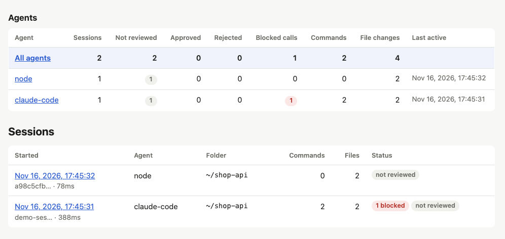
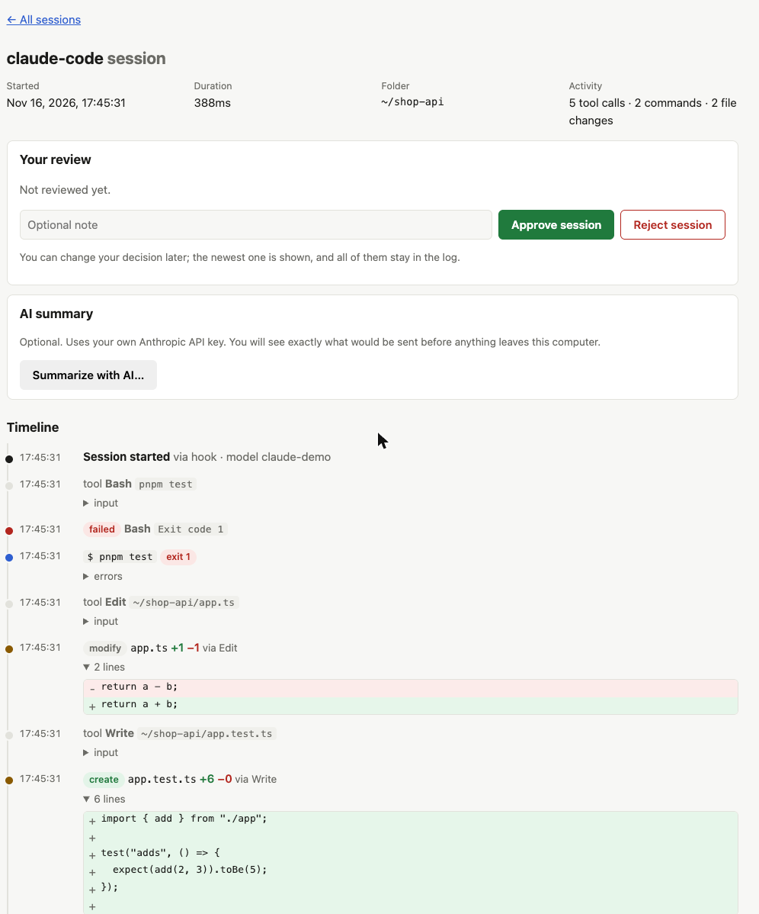

# Agent Review Desk

A workspace that records what AI coding agents (Claude Code, Codex) do on your machine, so a human can review the diffs and commands and **approve or reject** them.

> **Status: early development.**
> The free, local tier works end to end: record Claude Code sessions (`ard init`) or any agent (`ard run`), review them in a local web UI (`ard review`), approve or reject whole sessions, and have risky actions wait for your approval before they run.
> Paid plans are still in planning.

**Jump to:** [Quick start](#quick-start) · [**Usage**](docs/usage.md) · [Installation](#installation)

## Overview

AI agents change files, run shell commands and drive browsers. The record of who approved what usually ends up scattered across terminal scrollback and chat logs.

Agent Review Desk keeps one reviewable trail:

1. A CLI records agent execution events as JSONL.
2. A web dashboard shows diffs, commands and screenshots.
3. You approve or reject each run, and the decision is stored with the record.

It is built for development teams and agencies that use AI agents and need an audit trail.

### What it looks like

The review UI (`ard review`) on a throwaway demo project with made-up sessions. One row per agent, with how many sessions are still waiting for a decision and how many calls the policy blocked:



One session: your decision at the top, then the timeline. A failing test run, the edit that fixed it as a diff, and a new test file. In both pictures the folder path was shortened to `~/shop-api` by hand (the demo lives in a long temporary folder); your own UI shows the real path.



## Features

| Feature | Status |
|---|---|
| pnpm monorepo (`packages/schema`, `packages/core`, `packages/cli`, `apps/web`) | Done |
| Dev-time hook that blocks dangerous actions (see [Safety hook](#safety-hook)) | Done |
| JSONL event schema with validation (`@ard/schema`) | Done |
| `ard init` — registers Claude Code hooks in your project | Done |
| `ard hook` — records session, tool-use, command and file-change events from Claude Code hooks | Done |
| `ard run -- <agent>` — process wrapper for any agent (e.g. Codex): records the session and the files it changed, via git | Done |
| Redaction of API keys/tokens and size caps on everything written to the log | Done |
| Local SQLite index of the recordings (built-in `node:sqlite`, nothing to compile) | Done |
| `ard review` — local web UI: session list, timeline, diff viewer, command log | Done |
| Approve / reject a whole session after the fact | Done |
| **Pre-approval**: risky actions pause the agent until you approve them in the UI | Done (opt-in) |
| Default policy pack (14 rules) with per-rule overrides in `ard.config.json` | Done |
| Codex hooks (`ard init --agent codex`): sessions, shell commands and their output; risky-command blocking | Done (no exit code from Codex; checked on Codex 0.169.0) |
| `ard key set`: keep your Anthropic API key in the system keychain for the AI summary | Done (macOS, Linux with `secret-tool`) |
| `ard pr-status` / `ard pr-comment`: your review as a commit status and a comment on a pull request, no GitHub Actions | Done (tried end to end on a real pull request) |
| Multi-agent view in the review UI: per-agent overview, agent filter, `ard run` and hook sessions of one run linked | Done |
| AI summary of a session with your own Anthropic key (preview first, nothing sent without a second click) | Done (tried once against the real API with `claude-opus-5-5`) |
| Screenshots in the review UI: attach one by hand with `ard screenshot`, or keep the pictures found in tool results (opt-in, local only) | Done (hook capture verified on Claude Code with its `Read` tool on a picture and with a Claude in Chrome screenshot) |
| Paid plans: shared team workspace, cloud sync, roles, single sign-on | Planned |

### How it works

- **Capture** _(done)_: Claude Code hooks (`SessionStart`, `PreToolUse`, `PostToolUse`, `PostToolUseFailure`, `SessionEnd`) are the primary source of events. The `ard run` wrapper is a fallback for agents that have no hooks.
- **Store**: events are appended to `.ard/events.jsonl` in your project, on **your own machine**. That file is the source of truth. The review UI imports it into a local SQLite database (`.ard/data.db`), which is just an index plus the pending approval requests. Nothing leaves your computer on the free tier.
- **Approve**: with approvals on, a risky action makes the hook wait (the agent is paused) until you press Allow or Block in the review UI. See [Approvals](docs/usage.md#approvals-pause-risky-actions-until-you-say-so).
- **Your API keys stay yours**: the recorder wraps the agent CLI you already use and logged in to. It does not need your Anthropic/OpenAI API key. If a future feature needs one (for example AI summaries), it will be bring-your-own-key, stored in the OS keychain and never sent to our servers.

## Requirements

- Node.js **22.13 or newer** (developed on Node 24). The built-in SQLite module needs it.
- [pnpm](https://pnpm.io) 10
- Git

## Installation

The package is not published to npm yet. Install from source:

```bash
git clone https://github.com/Trapa-Eureka/agent-review-desk.git
cd agent-review-desk
pnpm install
pnpm build
```

Until the CLI is published, run it from the build output. For convenience, add an alias (adjust the path):

```bash
alias ard='node /path/to/agent-review-desk/packages/cli/dist/index.js'
```

Publishing to npm is planned (a GitHub release is source only). Once it is published, you will be able to install the CLI with:

```bash
npm install -g agent-review-desk
```

## Quick start

You need the build from [Installation](#installation) and the `ard` alias. Then, for any project:

1. **Register the recorder, once per project.** `cd your-project`, then
   - Claude Code: `ard init`, and restart Claude Code.
   - Codex: `ard init --agent codex`, then open Codex and run `/hooks` to trust the new hooks.
   - Any other agent (or to also catch file changes through git): `ard run -- <agent>` instead of starting it directly.
2. **Work as usual.** Everything the agent does is written to `.ard/` in that project (git-ignored, on your machine only).
3. **Review:** run `ard review` in the same folder, open the link it prints, open a session, read the timeline, and press **Approve session** or **Reject session**.
4. **Undo any time:** `ard init --remove` (or `ard init --agent codex --remove`). Your recordings stay.

Every command is explained in [Usage](docs/usage.md). Optional extras, each explained there: `ard init --approvals` pauses risky commands until you approve them in the UI; `ard key set` plus **Summarize with AI** gives a one-paragraph summary of a long session; `ard screenshot <file>` attaches a picture; `ard pr-status` and `ard pr-comment` show your review on a pull request (and can block merging until you have reviewed) without GitHub Actions.

## Usage

Every command is explained in **[docs/usage.md](docs/usage.md)**:

| I want to... | Read |
|---|---|
| record a Claude Code session | [Hooks for Claude Code](docs/usage.md#record-a-claude-code-session-hooks) |
| record a Codex session | [Hooks for Codex](docs/usage.md#record-a-codex-session-hooks) |
| record any other agent, or catch file changes through git | [The wrapper: `ard run`](docs/usage.md#record-any-agent-wrapper) |
| review, approve or reject sessions, and compare agents | [The review UI](docs/usage.md#review-sessions-web-ui) |
| get a one-paragraph summary of a long session (my own key) | [AI summary](docs/usage.md#ai-summary-bring-your-own-key) |
| show my review on a pull request, or block merging until I have reviewed | [Pull request gate](docs/usage.md#gate-a-pull-request-without-github-actions) |
| pause risky commands until I approve them | [Approvals](docs/usage.md#approvals-pause-risky-actions-until-you-say-so) |

### Develop this repository

```bash
pnpm build               # build all packages (the review UI needs this once)
pnpm typecheck
pnpm test                # schema, core and CLI tests
pnpm test:hooks          # tests for the dev-time safety hook
ard --help
```

The review UI is an ordinary Next.js app in `apps/web`; run it through `ard review` so it gets its project folder and access token.

## Event log

`.ard/events.jsonl` holds one JSON object per line (schema version 1, defined in `packages/schema`). Event types: `session_start`, `session_end`, `tool_use` (before/after each tool call), `command`, `file_change`, `approval` (a decision: written by the review UI for your clicks, and by the hook for policy denials and timeouts), and `screenshot` (a pointer to a picture kept in `.ard/screenshots/`).

Before anything is written, it is **redacted and size-capped**: API keys, tokens, private keys, `KEY=value` style secrets and values under secret-looking names are replaced with `[REDACTED]`; long output and file text are cut with a marker. The folder is created owner-only (`0700`, file `0600`).

Redaction is pattern-based and best effort. Treat `.ard/` as sensitive anyway and never commit it.

### Screenshots

```bash
ard screenshot login.png --caption "Login page after the fix"   # attach a picture to the latest session (or --session <id>)
ard init --screenshots                                          # also keep pictures that appear in tool results
```

- **A picture cannot be redacted.** It may show anything that was on the screen: tokens, personal data, other windows. That is why keeping pictures from tool results is **opt-in** (`"screenshots": true` in `ard.config.json`), and why screenshots stay on your machine.
- Pictures are stored in `.ard/screenshots/<sha256>` (owner-only; the same image is stored once). The log only holds a small `screenshot` event that points at the file.
- **Only PNG, JPEG, GIF and WebP are accepted**, judged from the file's first bytes, up to 8 MiB. SVG and everything else is refused (SVG can carry script). The review UI serves a picture only by its hash, never by a path.
- **Whether a hook receives the picture at all depends on the agent.** Claude Code's documentation does not say whether `PostToolUse` carries image data. Checked on Claude Code 2.1.325: when the agent reads a picture file with its `Read` tool, the hook does receive the image (`{ type: "image", file: { base64, … } }`) and ard keeps it. A Claude in Chrome screenshot also arrives (an `{ type: "image", source: { type: "base64", … } }` block inside the tool result) and is kept the same way; other browser or MCP tools were not tried, so capture from them is best effort. Whatever arrives, base64 image data is never written into the text log. `ard screenshot` always works.

## Known limitations

- Hook capture was first written against the Claude Code hooks documentation (November 2026) and then corrected against a real `Read` payload from Claude Code 2.1.325. Claude Code owns that format, so re-verify after major Claude Code updates.
- Claude Code reports no exit code for successful commands, so a recorded `exitCode: 0` means "the call succeeded". Failed commands carry the real exit code.
- The wrapper cannot see inside the agent, cannot see git-ignored files, and cannot attribute edits to a file that was already untracked before the run.
- The policy is a safety net, not a sandbox. It matches command text and file paths, so a wrapped, encoded or indirect command (`bash -c "$(…)"`, a script that does the deleting) can slip past it, and a harmless command that merely contains a dangerous-looking string can be flagged. It only gates what Claude Code's hooks see; the `ard run` wrapper cannot block anything.
- While a request waits, the agent is stuck. If you enable approvals, keep `ard review` open (or lower `timeoutSeconds`).
- On Codex, one interactive session ended a waiting approval from Codex's side after about 5 minutes, before ard's own timeout; the command did not run, and the leftover request expires by itself and can no longer be approved. Another run (`codex exec`) waited the full 300 seconds and blocked as designed. The cause of the first is not known, so answer requests promptly instead of relying on the timeout.
- The review UI shows what was recorded, which is redacted on a best-effort basis. It runs on your machine only (see [Data and privacy](#data-and-privacy)).
- Screenshots from tool results are best effort (see [Screenshots](#screenshots)); pictures are never redacted, only kept local and opt-in.
- macOS and Linux only; Windows is untested. Node's built-in SQLite is still marked experimental by Node; ard hides its startup warning.

## Paid plans (planned)

Everything that runs on your machine is free. Paid plans for team features that need a server (a shared workspace, roles, single sign-on) are in planning. Nothing is for sale yet, and prices and details are not decided.

## Safety hook

This repository ships a Claude Code `PreToolUse` hook (`.claude/hooks/block-dangerous.mjs`, configured in `.claude/settings.json`). While you develop in this repo with Claude Code, it blocks:

- broad recursive deletes (`rm -rf ~`, `rm -rf /`, ...)
- git force pushes, `reset --hard`, `clean -fd`
- staging secret or data files (`.env`, `.ard/`, `*.db`, keys, `git add -f`)
- destructive SQL (`DROP`, `TRUNCATE`, `DELETE` without `WHERE`)
- `curl | sh`, `npm publish`, and similar actions
- writing API-key-shaped strings or private keys into files

It is a safety net, not a complete defense: it matches command text, so a wrapped or obfuscated command can slip through, and an innocent command that merely contains a dangerous-looking string can be blocked.

## Data and privacy

- Your recorded data (`.ard/`, `*.db`, `*.jsonl`) stays on your machine and is excluded by `.gitignore`.
- Do not commit recorded data: it can contain code, file paths and sometimes secrets.
- Secrets (`.env`, keys, tokens) are never committed. Use `.env.example` for placeholders.
- `ard.config.json` holds only policy settings. It is meant to be committed.

### The review UI is locked down

It can approve actions an agent is waiting on and it shows your code, so a web page you merely visit must not be able to use it:

- It listens on `127.0.0.1` only, never on the network.
- Every `ard review` run creates a **new random token**. The printed link carries it once; the UI turns it into an `HttpOnly`, `SameSite=Strict` cookie and removes it from the address bar. Without it every page and API call is refused.
- Requests whose `Host` is not `127.0.0.1` / `localhost` are refused (blocks DNS-rebinding), and state-changing requests must come from the UI's own origin (blocks cross-site requests).
- It cannot be embedded in another page (`X-Frame-Options: DENY`, CSP `frame-ancestors 'none'`), so nobody can trick a click on **Allow**.
- A decision only counts while a request is still pending. A late click on an expired request is refused, so it can never look like an approval the agent did not get.

Anyone who can run commands as your user can read `.ard/` directly anyway; this protects against *websites and other network peers*, not against local malware.

## Project layout

```
agent-review-desk/
├── packages/
│   ├── schema/   # JSONL event schema and validation (@ard/schema)
│   ├── core/     # SQLite repository, policy engine, approvals, config, redaction (@ard/core)
│   ├── cli/      # the `ard` CLI (@ard/cli)
│   ├── billing/  # unreleased groundwork for the planned paid plans (@ard/billing)
│   ├── cloud/    # unreleased groundwork for the planned paid plans (@ard/cloud)
│   ├── summary/  # optional AI session summary with your own key: digest, prompt, request (@ard/summary)
│   └── ui/       # review components shared by the local UI and the planned team workspace (@ard/ui)
├── apps/
│   ├── web/      # local Next.js review UI (@ard/web), started by `ard review`
│   └── cloud/    # unreleased groundwork for the planned paid plans (@ard/cloud-web)
├── docs/unreleased/  # notes for the planned paid plans (not available)
├── .claude/
│   ├── settings.json
│   └── hooks/    # dev-time blocking hook and its tests
├── CLAUDE.md     # short guidance for AI agents working in this repo
└── pnpm-workspace.yaml
```

## Roadmap

- [x] **Phase 0** — monorepo, `CLAUDE.md`, safety hook
- [x] **Phase 1** — event schema, `ard init`, `ard hook`, `ard run`
- [x] **Phase 2** — SQLite storage layer, review UI, approve/reject, pre-approval of risky actions
- [ ] **Phase 3** — paid plans: cloud sync, shared team workspace, roles, single sign-on, billing (planned)
- [x] **Phase 4** — optional: ~~bring-your-own-key AI summaries~~ (done), ~~Codex hook adapter~~ (done), ~~PR gate and comment without Actions~~ (done: `ard pr-status`, `ard pr-comment`), ~~multi-agent view~~ (done: per-agent overview, agent filter, linked `ard run` and hook sessions)

## Contributing

The project is at an early stage. Please open an issue to discuss a change before sending a pull request. All files in this repository are written in English.

Found a security problem? Please do not open a public issue; see [SECURITY.md](SECURITY.md).

## License

[MIT](LICENSE).
